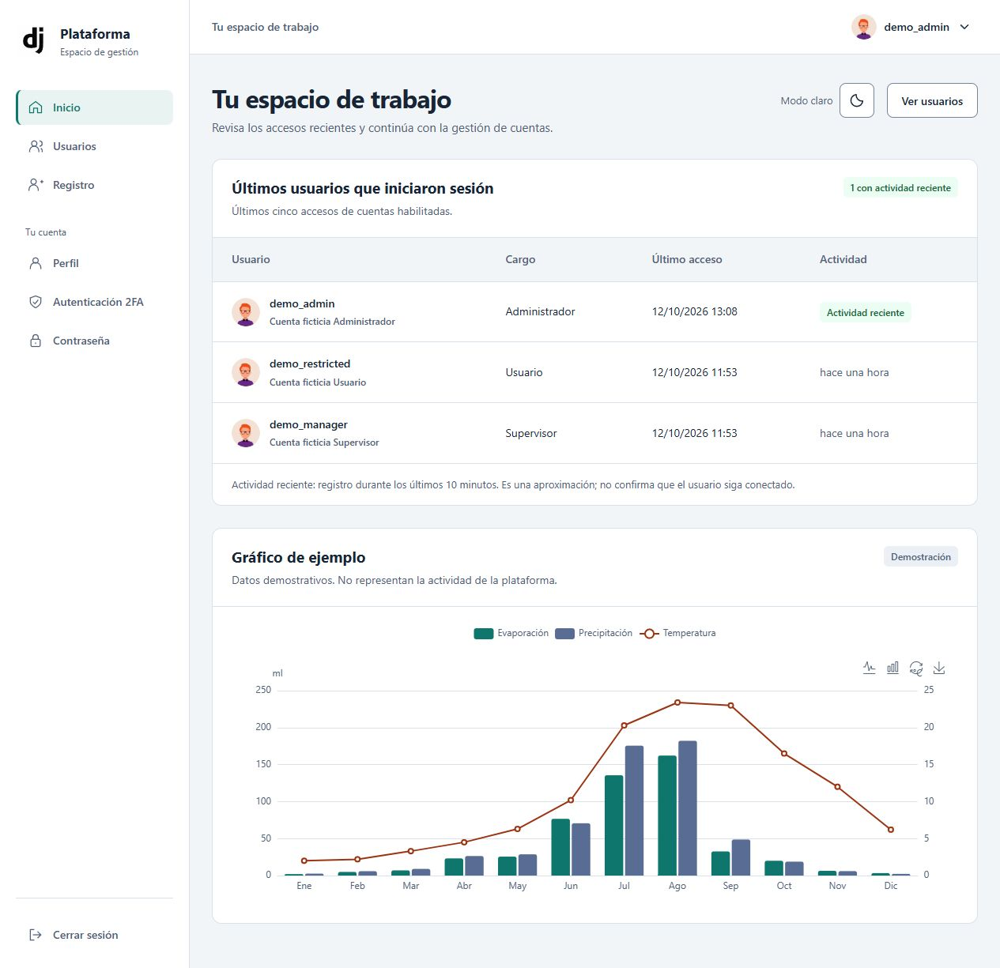
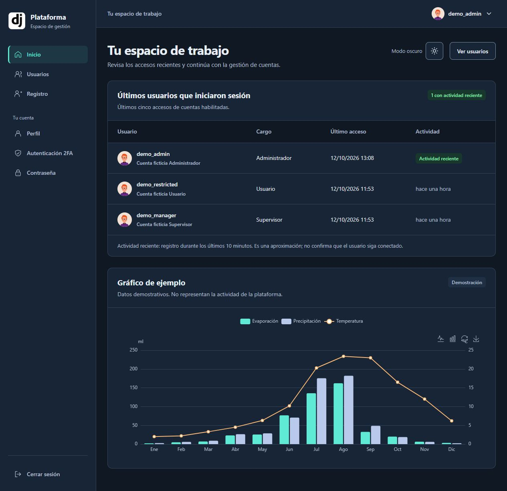
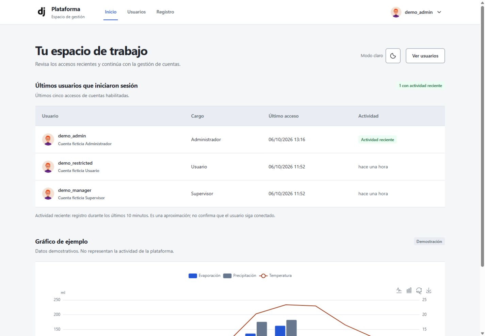
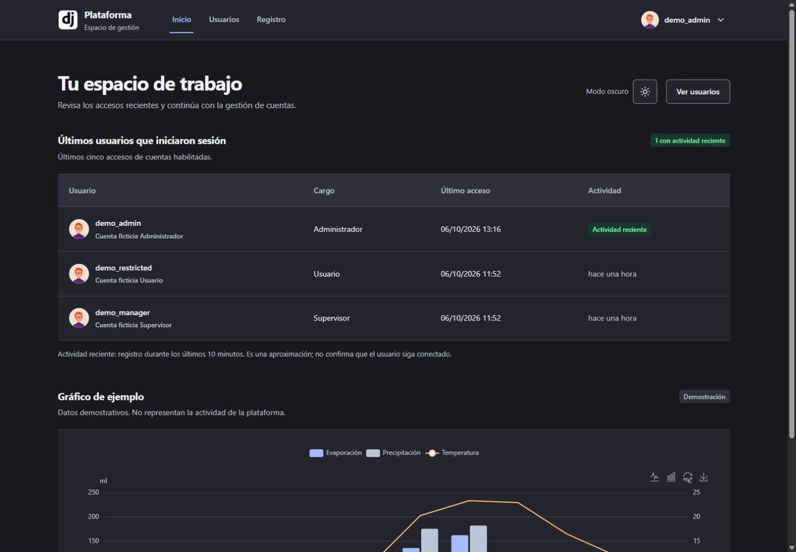
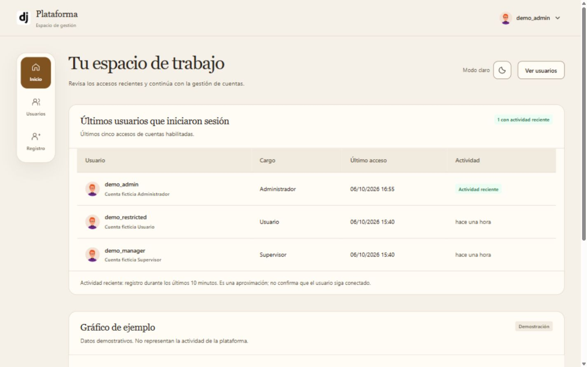
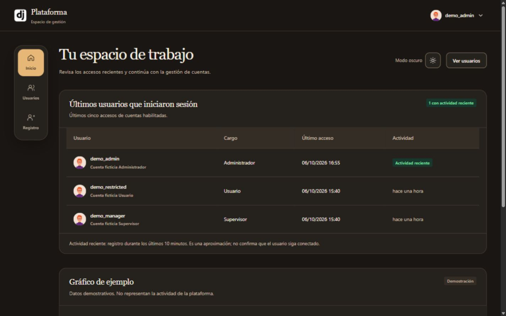

# Base Django · tres propuestas visuales

[](https://github.com/fersrm/Base-2/actions/workflows/ci.yml)

Base reutilizable con usuarios, perfiles y cargos, autenticación allauth, MFA, navegación y modo claro/oscuro por cuenta. Django Templates, Tailwind standalone y crispy-tailwind. Idioma `es-cl`, zona `America/Santiago`; todavía sin módulo de negocio.

## Elige un diseño

Las tres ramas conservan la misma base funcional y ofrecen distintas presentaciones. `main` utiliza el diseño 1. Las capturas de Inicio contienen cuentas ficticias y un gráfico demostrativo.

| Propuesta | Rama | Presentación |
| --- | --- | --- |
| [Diseño 1](https://github.com/fersrm/Base-2/tree/codex/diseno-1) | `codex/diseno-1` | Menú lateral y paleta petróleo |
| [Diseño 2](https://github.com/fersrm/Base-2/tree/codex/diseno-2) | `codex/diseno-2` | Navegación superior y presentación compacta |
| [Diseño 3](https://github.com/fersrm/Base-2/tree/codex/diseno-3) | `codex/diseno-3` | Navegación lateral compacta, tonos cálidos y títulos serif |

### Diseño 1

| Claro | Oscuro |
| --- | --- |
|  |  |

### Diseño 2

| Claro | Oscuro |
| --- | --- |
|  |  |

### Diseño 3

| Claro | Oscuro |
| --- | --- |
|  |  |

## Clonar e instalar

Requiere Python 3.12. El repositorio es privado: usa una cuenta o clave de despliegue con acceso de lectura. Este ejemplo para Linux descarga únicamente la rama elegida y su último estado, sin el historial de documentación y evidencias antiguas:

```bash
git clone --depth 1 --single-branch --branch codex/diseno-1 git@github.com:fersrm/Base-2.git
cd Base-2
python3.12 -m venv .venv
source .venv/bin/activate
python -m pip install -r requirements.txt
python -m pip check
```

Sustituye la rama por `codex/diseno-2`, `codex/diseno-3` o `main`. En Windows crea el entorno con `py -3.12 -m venv .venv` y actívalo con `.\.venv\Scripts\Activate.ps1`.

Las versiones Python están fijadas en `requirements.txt`; no copies entornos virtuales entre equipos. Tailwind 4.3.0 usa un binario standalone, sin npm/Node.js. Su CSS compilado se conserva en `theme/static/css/dist/styles.css`.

## Configuración de cada instalación

Crea `.env` en la raíz, protegido y excluido de Git. En una instalación nueva genera una clave propia con:

```bash
python -c "from django.core.management.utils import get_random_secret_key; print(get_random_secret_key())"
```

Guarda el resultado únicamente en el entorno de esa instalación. Al actualizar o trasladar una instalación existente, conserva su `SECRET_KEY` para mantener las firmas y sesiones existentes. Respalda conjuntamente configuración, base y archivos antes de actualizar. Los autenticadores MFA están en la base; el adaptador actual de allauth no añade cifrado a sus secretos, por lo que la base y sus respaldos requieren protección propia.

### Desarrollo local · HTTP

Usa una clave exclusiva de desarrollo y estos valores en tu `.env` local:

```dotenv
SECRET_KEY=<genera-una-clave-unica>
DEBUG=True
ALLOWED_HOSTS=127.0.0.1,localhost
CSRF_TRUSTED_ORIGINS=http://127.0.0.1:8000,http://localhost:8000
SECURE_SSL_REDIRECT=False
SESSION_COOKIE_SECURE=False
CSRF_COOKIE_SECURE=False
SECURE_HSTS_SECONDS=0
```

### Producción · HTTPS

Usa una clave exclusiva de esa instalación y reemplaza el dominio de ejemplo por el del servidor:

```dotenv
SECRET_KEY=<genera-una-clave-unica-para-esta-instalacion>
DEBUG=False
ALLOWED_HOSTS=plataforma.example.org
CSRF_TRUSTED_ORIGINS=https://plataforma.example.org
SECURE_SSL_REDIRECT=True
SESSION_COOKIE_SECURE=True
CSRF_COOKIE_SECURE=True
SECURE_HSTS_SECONDS=3600
```

Las variables anteriores se leen en `core/settings.py`. La base se selecciona en `.env` con `DATABASE_URL=sqlite:///db.sqlite3`; si se omite, se conserva SQLite en `db.sqlite3`. Las rutas SQLite relativas parten de la raíz del proyecto. [`.env.example`](.env.example) incluye la configuración local y alternativas comentadas para PostgreSQL y MySQL: activa solo una `DATABASE_URL`, crea la base e instala el controlador correspondiente (`psycopg` o `mysqlclient`) antes de cambiar de motor. Cambiar la URL no traslada los datos existentes. El correo sigue usando consola; configurar SMTP requiere adaptar y verificar los settings.

La configuración confía en `HTTP_X_FORWARDED_PROTO=https`. Comprueba que el proxy del destino establezca ese encabezado y controle los valores enviados por el cliente. Las pruebas usan `core.test_settings`, que no lee `.env`; no uses esos settings para servir la aplicación.

## Instalación del esquema y cuenta inicial

La configuración normal usa SQLite en `db.sqlite3`. Sobre una **instalación nueva y una base vacía**, prepara tablas y la cuenta inicial:

```bash
python manage.py migrate
python manage.py createsuperuser
```

Los cargos se representan con `UsuarioApp.Position` y el perfil relaciona la cuenta con su cargo. Las acciones administrativas y Registro exigen cargo incluso al superusuario; configura el cargo ADMIN del operador desde el administrador Django en `/admin/`. No hay cuentas ni contraseñas iniciales incluidas.

Para una base existente, respalda y ensaya las migraciones antes de aplicarlas. Está disponible `python manage.py verificar_actualizacion_allauth --help` para conocer el preflight de actualización.

Para iniciar desarrollo con el `.env` HTTP descrito arriba:

```bash
python manage.py runserver
```

## CI y verificación local

[El workflow de CI](.github/workflows/ci.yml) se ejecuta en push/PR de `main` y las ramas `codex/diseno-*`, además de permitir ejecución manual. Usa Ubuntu y Python 3.12, instala las dependencias, ejecuta `pip check`, las comprobaciones Django, detecta migraciones pendientes y corre la suite de `UsuarioApp` y `homeApp`.

```bash
python manage.py check --settings=core.test_settings
python manage.py makemigrations --check --dry-run --settings=core.test_settings
python manage.py test UsuarioApp homeApp --noinput --settings=core.test_settings
```

`core.test_settings` no lee `.env`: utiliza SQLite en memoria, correo/caché locales y archivos temporales. La suite actual contiene 76 pruebas. CI no aplica migraciones a tu base ni despliega el proyecto.

## Preparar el servidor

Configura el `.env` de producción descrito arriba y prepara el servidor WSGI según tu hosting. La entrada es `core.wsgi:application` (módulo `core.wsgi`, objeto `application`); el servidor WSGI no está incluido en las dependencias actuales.

```bash
python manage.py check --deploy
python manage.py collectstatic --noinput
```

Sirve `/static/` desde `staticfiles/` y `/media/` desde `media/`. La base y las subidas necesitan almacenamiento persistente, permisos y respaldo/restauración propios: clonar el código no recupera cuentas, MFA ni fotos. Configura correo, logs y acceso según la instalación. Axes y preventconcurrentlogins permanecen desactivados. `runserver` es solo para desarrollo. El alojamiento y el servidor WSGI se configuran por instalación; este repositorio incorpora únicamente CI.

## Personalizar y mantener liviana la copia

Los colores se centralizan en `static/css/tokens.css`. Si cambias clases, plantillas o fuentes Tailwind, recompila:

```bash
python manage.py tailwind --settings=core.test_settings install
python manage.py tailwind --settings=core.test_settings build
```

Conserva las raíces de fuentes en `theme/static_src/src/styles.css` y versiona el CSS compilado. Cambiar valores de colores existentes no exige compilar.

Se versionan código, migraciones, pruebas, dependencias, estáticos y seis capturas para este README. Se excluyen `.env`, bases, archivos personales, entornos, cachés, binarios descargados y `staticfiles/`. Por decisión del propietario, docs/specs/prompts, instrucciones SDD y skills locales se conservan en el equipo y quedan fuera del seguimiento desde esta entrega. El historial Git previo se conserva; el clon superficial de arriba evita descargarlo. Las capturas de presentación no se incluyen en `collectstatic`.
